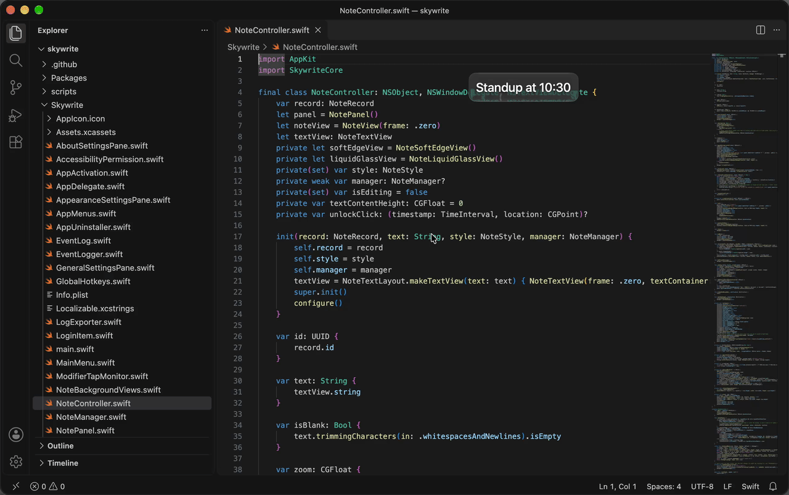
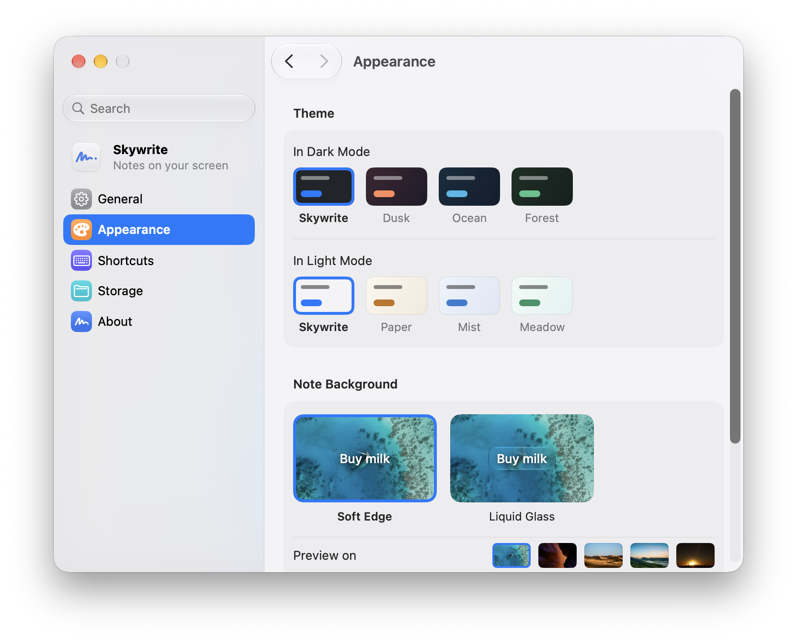

# Skywrite

English · [简体中文](README.zh-Hans.md) · [繁體中文](README.zh-Hant.md)

Skywrite puts notes on your screen, above your other windows. A note has no window frame, so it takes up little more space than its text.



Each note is saved as a Markdown file in a folder you choose. You can move, resize, zoom and pin notes, or hide them all with ⌃⌥H. The menu bar and Dock menus list your pinned notes and the ones you edited most recently, closed or not.

Notes have no background by default. Settings › Appearance offers Soft Edge and Liquid Glass backgrounds; the notes above use Liquid Glass.

<picture>
  <source media="(prefers-color-scheme: dark)" srcset=".github/screenshots/settings-dark.png">
  
</picture>

## Install

Requires macOS 26 or later. Supports Apple silicon.

Download and unzip `Skywrite-<version>.zip` from the [latest release](https://github.com/GooZhenJie/skywrite/releases/latest), then move **Skywrite** to **Applications**.

### First launch

The first time you open Skywrite, macOS may refuse to open it, saying it can't check the app for malware. When that happens, open **System Settings › Privacy & Security**, click **Open Anyway** under **Security**, click **Open Anyway** again when macOS asks, then use Touch ID or enter your password. See [Apple’s instructions](https://support.apple.com/guide/mac-help/open-a-mac-app-from-an-unknown-developer-mh40616/mac).

### Install from source

With macOS 26 and Xcode installed:

```bash
git clone https://github.com/GooZhenJie/skywrite.git
cd skywrite
scripts/install-from-source.sh
```

The script builds and opens `/Applications/Skywrite.app`, quitting any running copy first and moving the previous installation to the Trash. Your notes and settings are preserved. Locally built copies do not trigger the downloaded-app warning.

## Using Skywrite

Press **⌃⌥N** to create a note. Click to place it, or drag to set its size. Press **Esc** to cancel placement.

Type your note, then press **Esc** or click elsewhere to finish editing. The note stays above other windows. Click it to edit again, drag it to move it, or double-click to close it. Closing a note keeps its file; reopen it from the menu bar or Dock menu.

| Action | Control |
| --- | --- |
| Create a note | ⌃⌥N |
| Hide or show all notes | ⌃⌥H |
| Reopen the last closed note | ⌃⌥Z, or ⌘Z while Skywrite is active |
| Resize a note | Drag a corner or dashed edge while editing |
| Zoom a note | Scroll or pinch over it |
| Change text size across all notes | ⌘+ / ⌘− |
| Pin a note | Right-click › **Pin Note** |
| Fit a note to its text | Right-click › **Fit Size to Text** |
| Reset a note’s zoom | Right-click › **Reset Zoom** |


## Privacy

Skywrite has no accounts, analytics or crash reporting. Notes stay in your chosen folder; the app does not sync them or send their contents anywhere. The only network request is the update check, which Skywrite asks about on the second launch and you can turn off in Settings › General.

## Credits

The Appearance preview uses photos from [Unsplash](https://unsplash.com):

- [Sea](https://unsplash.com/photos/BMJWpck6eQA) — Ishan @seefromthesky
- [Canyon](https://unsplash.com/photos/ZDriZvoHeKk) and [Dunes](https://unsplash.com/photos/p3NOK6MhvKQ) — Francesco Ungaro
- [Mountains](https://unsplash.com/photos/PwzISwC2kLs) — Arindam Saha
- [City](https://unsplash.com/photos/SwIh3kr1__U) — Nathan Dumlao

Automatic updates use [Sparkle](https://sparkle-project.org), available under the [MIT License](https://github.com/sparkle-project/Sparkle/blob/2.x/LICENSE).

## Contributing

Bug reports, ideas and pull requests are welcome. See [CONTRIBUTING.md](CONTRIBUTING.md).

## License

[MIT](LICENSE). Preview photos in `Skywrite/Assets.xcassets/PreviewBackdrops/` remain the property of their photographers and are used under the [Unsplash License](https://unsplash.com/license).
