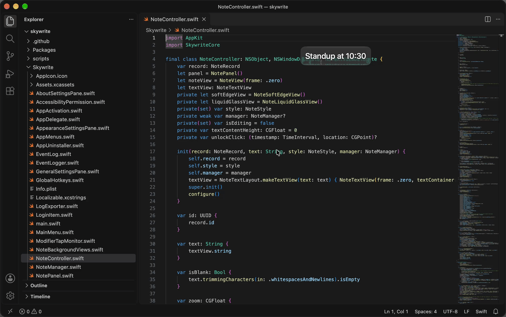
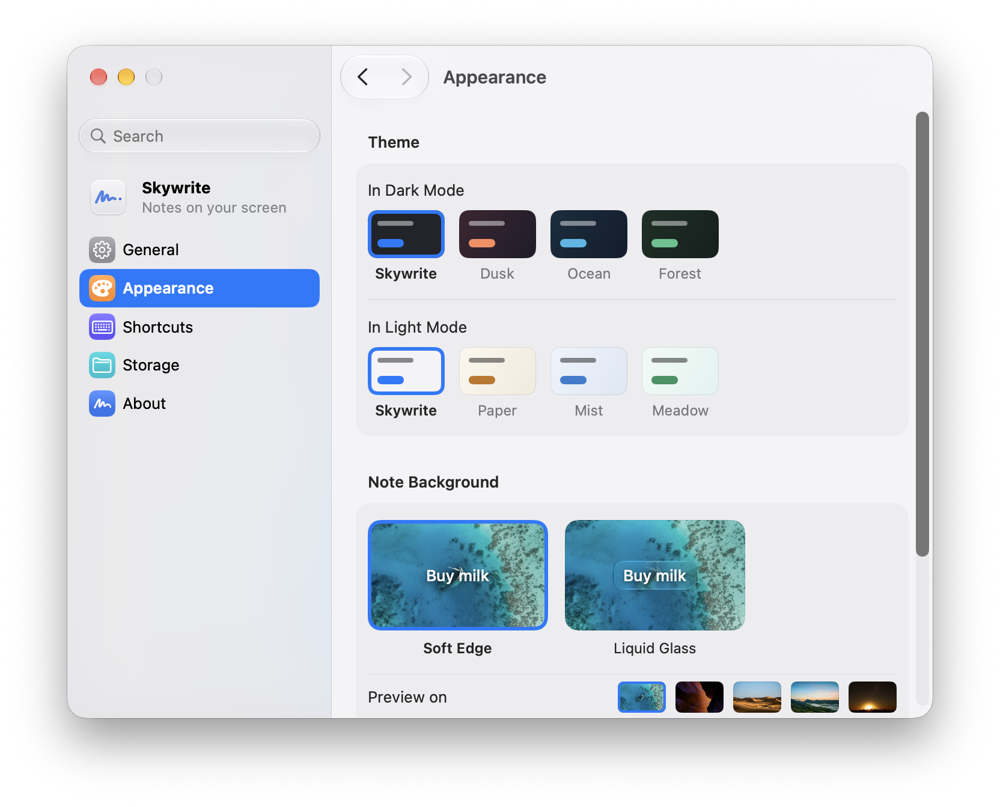

# Skywrite

[English](README.md) · 简体中文 · [繁體中文](README.zh-Hant.md)

Skywrite 把便签放在屏幕上，浮在其他窗口之上。便签没有窗口边框，占的地方和文字本身差不多大。



每张便签都存成一个 Markdown 文件，放在你选的文件夹里。便签可以移动、调整大小、缩放和置顶，也可以用 ⌃⌥H 一次隐藏全部便签。菜单栏和 Dock 的菜单会列出置顶的便签和最近编辑过的便签，关掉的也在里面。

便签默认没有背景。设置 › 外观里可以选柔边或液态玻璃背景，上面动图里用的是液态玻璃。

<picture>
  <source media="(prefers-color-scheme: dark)" srcset=".github/screenshots/settings-dark.png">
  
</picture>

## 安装

需要 macOS 26 或更新版本，支持 Apple 芯片。

从[最新版本](https://github.com/GooZhenJie/skywrite/releases/latest)下载 `Skywrite-<版本>.zip` 并解压，再把 **Skywrite** 移到「应用程序」文件夹。

### 第一次打开

第一次打开 Skywrite 时，macOS 可能会拒绝打开，提示无法检查它是否含有恶意软件。遇到这种情况，打开**系统设置 › 隐私与安全**（macOS 26 上叫「隐私与安全性」），在**安全性**下面点**仍要打开**，macOS 再次询问时再点一次**仍要打开**，然后用触控ID 或输入密码。参见[苹果的说明](https://support.apple.com/zh-cn/guide/mac-help/mh40616/mac)。

### 从源码安装

装好 macOS 26 和 Xcode 后：

```bash
git clone https://github.com/GooZhenJie/skywrite.git
cd skywrite
scripts/install-from-source.sh
```

脚本会编译并打开 `/Applications/Skywrite.app`。如果 Skywrite 正在运行，会先退出它，再把旧版移到废纸篓。便签和设置都会保留。自己编译的版本不会出现上面那个下载 App 的提示。

## 使用

按 **⌃⌥N** 新建便签。点一下放下便签，或者拖一个框定大小。按 **Esc** 取消。

写好以后按 **Esc** 或点别处结束编辑，便签会留在其他窗口上面。点它可以再次编辑，拖它可以移动，连点两下关闭。关闭便签不会删除文件，可以从菜单栏或 Dock 的菜单里重新打开。

| 操作 | 方法 |
| --- | --- |
| 新建便签 | ⌃⌥N |
| 隐藏或显示全部便签 | ⌃⌥H |
| 重新打开刚关闭的便签 | ⌃⌥Z；Skywrite 在前台时也可以按 ⌘Z |
| 调整便签大小 | 编辑时拖动角或虚线边 |
| 缩放便签 | 在便签上滚动或双指捏合 |
| 一起调整所有便签的字号 | ⌘+ / ⌘− |
| 置顶便签 | 右键 › **置顶便签** |
| 让便签大小贴合文字 | 右键 › **大小跟着字走** |
| 恢复便签的缩放 | 右键 › **恢复原始大小** |

## 隐私

Skywrite 没有账号，不收集使用数据，也不上报崩溃。便签只存在你选的文件夹里，Skywrite 不会同步它们，也不会把内容发到任何地方。唯一的网络请求是检查更新：第二次打开时 Skywrite 会问你要不要自动检查，之后也可以在设置 › 通用里关掉。

## 致谢

外观页的预览用了 [Unsplash](https://unsplash.com) 上的照片：

- [海面](https://unsplash.com/photos/BMJWpck6eQA)：Ishan @seefromthesky
- [峡谷](https://unsplash.com/photos/ZDriZvoHeKk)、[沙丘](https://unsplash.com/photos/p3NOK6MhvKQ)：Francesco Ungaro
- [山峦](https://unsplash.com/photos/PwzISwC2kLs)：Arindam Saha
- [城市](https://unsplash.com/photos/SwIh3kr1__U)：Nathan Dumlao

自动更新用的是 [Sparkle](https://sparkle-project.org)，采用 [MIT 许可证](https://github.com/sparkle-project/Sparkle/blob/2.x/LICENSE)。

## 参与贡献

欢迎提交问题、想法和 pull request，见 [CONTRIBUTING.md](CONTRIBUTING.md)（英文）。

## 许可证

[MIT](LICENSE)。`Skywrite/Assets.xcassets/PreviewBackdrops/` 里的预览照片版权归摄影师所有，按 [Unsplash 许可](https://unsplash.com/license)使用。
