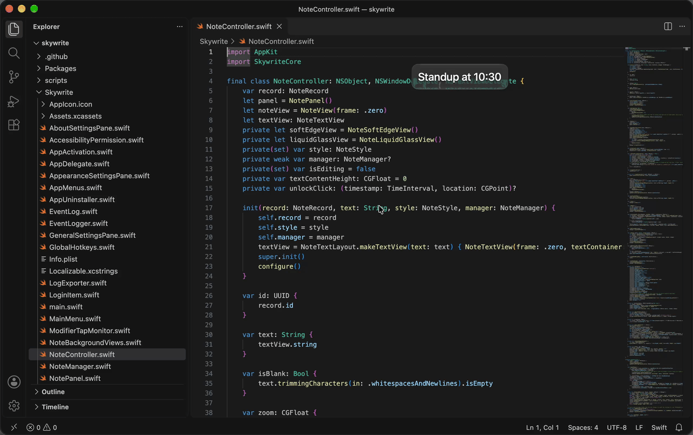
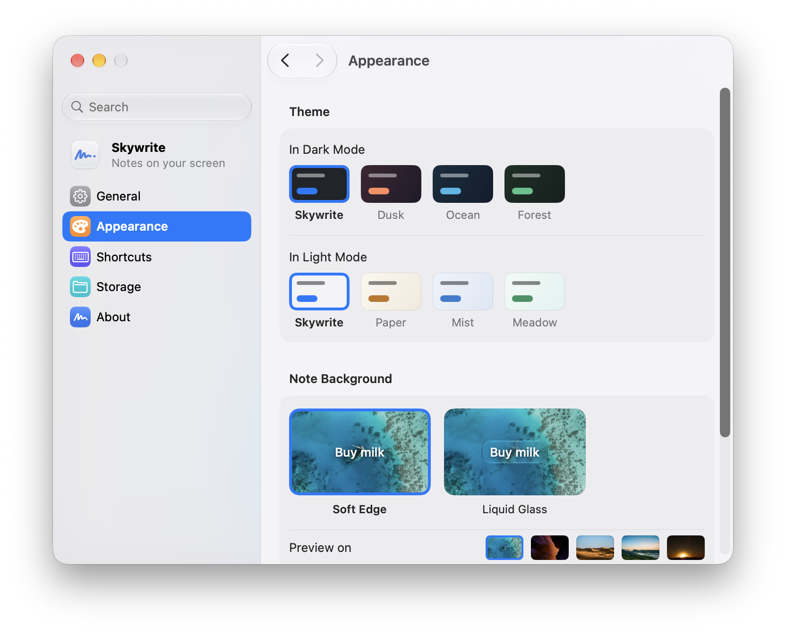

# Skywrite

[English](README.md) · [简体中文](README.zh-Hans.md) · 繁體中文

Skywrite 把便條放在螢幕上，浮在其他視窗之上。便條沒有視窗邊框，佔的地方和文字本身差不多大。



每張便條都存成一個 Markdown 檔案，放在你選的檔案夾裡。便條可以移動、調整大小、縮放和釘選，也可以用 ⌃⌥H 一次隱藏全部便條。選單列和 Dock 的選單會列出釘選的便條和最近編輯過的便條，關掉的也在裡面。

便條預設沒有背景。設定 › 外觀裡可以選柔邊或液態玻璃背景，上面動圖裡用的是液態玻璃。

<picture>
  <source media="(prefers-color-scheme: dark)" srcset=".github/screenshots/settings-dark.png">
  
</picture>

## 安裝

需要 macOS 26 或更新版本，支援 Apple 晶片。

從[最新版本](https://github.com/GooZhenJie/skywrite/releases/latest)下載 `Skywrite-<版本>.zip` 並解壓縮，再把 **Skywrite** 移到「應用程式」檔案夾。

### 第一次打開

第一次打開 Skywrite 時，macOS 可能會拒絕打開，提示無法檢查它是否為惡意軟體。遇到這種情況，打開**系統設定 › 隱私權與安全性**，在**安全性**下面按一下**強制打開**，macOS 再次詢問時再按一次**強制打開**，然後使用 Touch ID 或輸入密碼。香港的系統上，這幾項顯示為「私隱與保安」「保安」「強制開啟」。參見 [Apple 的說明](https://support.apple.com/zh-tw/guide/mac-help/mh40616/mac)。

### 從原始碼安裝

裝好 macOS 26 和 Xcode 後：

```bash
git clone https://github.com/GooZhenJie/skywrite.git
cd skywrite
scripts/install-from-source.sh
```

腳本會編譯並打開 `/Applications/Skywrite.app`。如果 Skywrite 正在執行，會先結束它，再把舊版丟到垃圾桶。便條和設定都會保留。自己編譯的版本不會出現上面那個下載 App 的提示。

## 使用

按 **⌃⌥N** 新增便條。按一下放下便條，或拖一個框決定大小。按 **Esc** 取消。

寫好以後按 **Esc** 或按一下別處結束編輯，便條會留在其他視窗上面。按一下可以再次編輯，拖移可以移動，連按兩下關閉。關閉便條不會刪除檔案，可以從選單列或 Dock 的選單裡重新打開。

| 操作 | 方法 |
| --- | --- |
| 新增便條 | ⌃⌥N |
| 隱藏或顯示全部便條 | ⌃⌥H |
| 重新打開剛關閉的便條 | ⌃⌥Z；Skywrite 在前景時也可以按 ⌘Z |
| 調整便條大小 | 編輯時拖移角落或虛線邊 |
| 縮放便條 | 在便條上捲動或用兩指縮放 |
| 一起調整所有便條的文字大小 | ⌘+ / ⌘− |
| 釘選便條 | 按右鍵 › **釘選便條** |
| 讓便條大小貼合文字 | 按右鍵 › **大小跟著字走** |
| 回復便條的縮放 | 按右鍵 › **回復原始大小** |

## 隱私權

Skywrite 沒有帳號，不收集使用資料，也不回報當機。便條只存在你選的檔案夾裡，Skywrite 不會同步它們，也不會把內容傳到任何地方。唯一的網路請求是檢查更新項目：第二次打開時 Skywrite 會問你要不要自動檢查，之後也可以在設定 › 一般裡關閉。

## 致謝

外觀頁的預覽用了 [Unsplash](https://unsplash.com) 上的照片：

- [海面](https://unsplash.com/photos/BMJWpck6eQA)：Ishan @seefromthesky
- [峽谷](https://unsplash.com/photos/ZDriZvoHeKk)、[沙丘](https://unsplash.com/photos/p3NOK6MhvKQ)：Francesco Ungaro
- [山巒](https://unsplash.com/photos/PwzISwC2kLs)：Arindam Saha
- [城市](https://unsplash.com/photos/SwIh3kr1__U)：Nathan Dumlao

自動更新用的是 [Sparkle](https://sparkle-project.org)，採用 [MIT 授權](https://github.com/sparkle-project/Sparkle/blob/2.x/LICENSE)。

## 參與貢獻

歡迎提交問題、想法和 pull request，見 [CONTRIBUTING.md](CONTRIBUTING.md)（英文）。

## 授權

[MIT](LICENSE)。`Skywrite/Assets.xcassets/PreviewBackdrops/` 裡的預覽照片版權歸攝影師所有，依 [Unsplash 授權](https://unsplash.com/license)使用。
